  

# kitden-sdlc

AI reviewers, a client watcher and a release flow for
[Kitden](https://github.com/KonstantinStarovoytov/kitden), with rules so no agent job holds
untrusted text, a secret and write access at once.

 

| Part | What it does | Status |
|---|---|---|
| Review ([review.yml](.github/workflows/review.yml)) | Claude and Luna read each pull request; the Lantern app posts one "Agent review" comment | live on Kitden |
| Workflow check ([check.yml](.github/workflows/check.yml)) | zizmor, actionlint and the rule checker on every workflow change | live on Kitden |
| Client watcher ([watch.yml](.github/workflows/watch.yml)) | Claude Sonnet 5.5 reads the release notes of Claude Code, Codex and Cursor; a script opens issues in Kitden | live: every day; the eval runs by hand |
| Weekly numbers ([numbers.yml](.github/workflows/numbers.yml)) | counts the reviews, no model | live: every Monday |
| Release prep ([release-prep.yml](.github/workflows/release-prep.yml)) | Claude drafts the notes, README and policy edits with read-only tools; a job without a model opens the release pull request | ready in Kitden; the first release with it is still to come |
| Publish ([publish.yml](.github/workflows/publish.yml)) | no model; in the `release` environment it moves the `release` branch and opens the Homebrew pull request, and it publishes to the MCP Registry | ready in Kitden; the first release with it is still to come |
| Release watch ([release-watch.yml](.github/workflows/release-watch.yml)) | daily, no model: an issue when a release is due or a store is behind | set up in Kitden; runs every day |

Every agent, its model and its limits: [docs/agents.md](docs/agents.md).

## The bots

All the automation posts as one of three GitHub Apps, so you always see which one did what.

| | Bot | What it does |
|---|---|---|
|  | **Lantern** `kitden-lantern[bot]` | posts the "Agent review" comment; opens the watcher's and the release watch's issues |
|  | **Kitden Beacon** `kitden-beacon` | opens the release pull request, tags the release, moves the `release` branch, opens the Homebrew pull request |
|  | **Kitden Kettle** `kitden-kettle` | keeps the Homebrew formula up to date in the tap, every day |

## How it works

| When | What runs | You do | You hear |
|---|---|---|---|
| A pull request to `main` | Claude and Luna review it; Lantern posts one "Agent review" comment | read it; merging is yours | a comment |
| A pull request changes a workflow | zizmor, actionlint, the rule checker | fix a red check | a red check |
| Every day, 05:17 UTC | the client watcher reads Claude Code, Codex and Cursor notes | close each issue with `confirmed` or `false-alarm` | an issue for a sure major problem (two a week at most); a summary on Monday |
| Every day, 06:23 UTC | the release watch, no model | run Release prep (the issue links to it), or re-run what it names | "Time for a release?", "Release vX.Y.Z is not everywhere" |
| Every Monday, 06:00 UTC | the weekly numbers, no model | nothing | nothing |

Bots never write `@name`. Every issue a bot opens has the label `automated`.

### Review

<picture>
  <source media="(prefers-color-scheme: dark)" srcset="docs/images/review-dark.svg">
  
</picture>

### Client watcher

<picture>
  <source media="(prefers-color-scheme: dark)" srcset="docs/images/watcher-dark.svg">
  
</picture>

### Release

<picture>
  <source media="(prefers-color-scheme: dark)" srcset="docs/images/release-dark.svg">
  
</picture>

You never open an issue for a release. In Kitden on GitHub: **Actions → Release prep → Run
workflow**, keep "Use workflow from" on `main`, keep the version on **Auto** (or pick
**Features (0.X.0)** or **Fixes (0.0.X)**), press the green **Run workflow**. Then review and
merge the pull request **Kitden X.Y.Z**. The bot's issue "Time for a release?" links to the
same page. Do not open issues with the bots' titles yourself: the bot finds its issues by the
exact title and would rewrite or close yours.

Two switches stop it all: `AGENTS_ENABLED` (everything) and `WATCH_LIVE` (the watcher's daily
run).

## The rules

Every workflow that runs an agent must follow [RULES.md](RULES.md). A script checks them.

1. No job holds untrusted text, a secret and write permission together. A job in the
   `release` environment never runs a model.
2. `pull_request` only; skip forks, bots and when the switch is off. A scheduled agent runs
   on a schedule or by hand only, and every job checks the switch.
3. `permissions: {}` at the top; each job asks for the least.
4. Every action is pinned to a full SHA. The caller may use this repository's workflows at
   `main`, which is protected.
5. Every agent job has a timeout, a turn limit and one run per pull request. Luna has only
   the 15 minutes. An agent that is a script has `MAX_MODEL_CALLS` and runs one at a time.
6. Tools are allowed by exact name: no Bash, web or MCP. Claude reads only the checkout. Luna
   can run shell commands, but only in a read-only sandbox without network, and it can read
   more than the checkout.
7. Secrets arrive as named inputs and are never printed; the Claude token and the OpenAI key
   never share a job.
8. An agent's comment starts with one line saying it is automated and which model wrote it
   (today the "Agent review" title).

## Copy this

The callers in [examples/](examples/) are Kitden's own workflow files. Copy them into your
`.github/workflows/`, rewrite the Kitden-specific skills and prompts, then do the one-time
setup: [docs/setup.md](docs/setup.md) for review and the watcher,
[docs/release-setup.md](docs/release-setup.md) for the release flow.

## More

- [docs/agents.md](docs/agents.md): every agent and workflow, the watcher's labels, the release flow
- [docs/setup.md](docs/setup.md) and [docs/release-setup.md](docs/release-setup.md): the one-time setup
- [LOG.md](LOG.md): what went wrong while building, and what changed
- Designs: [reviewers](docs/design.md), [client watcher](docs/watcher-design.md),
  [release flow](docs/superpowers/specs/2026-11-12-release-flow-design.md)
- [MERGE_POLICY.md](MERGE_POLICY.md): the reviewers only comment, never approve or block
- Evals: [review tasks](evals/README.md), [watch tasks](evals/watch/README.md)
