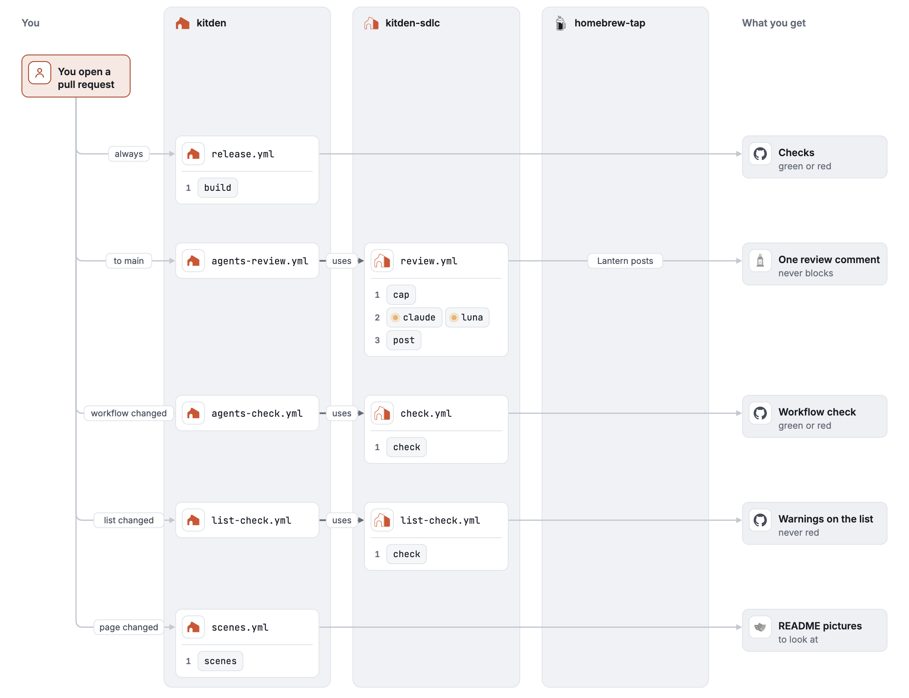
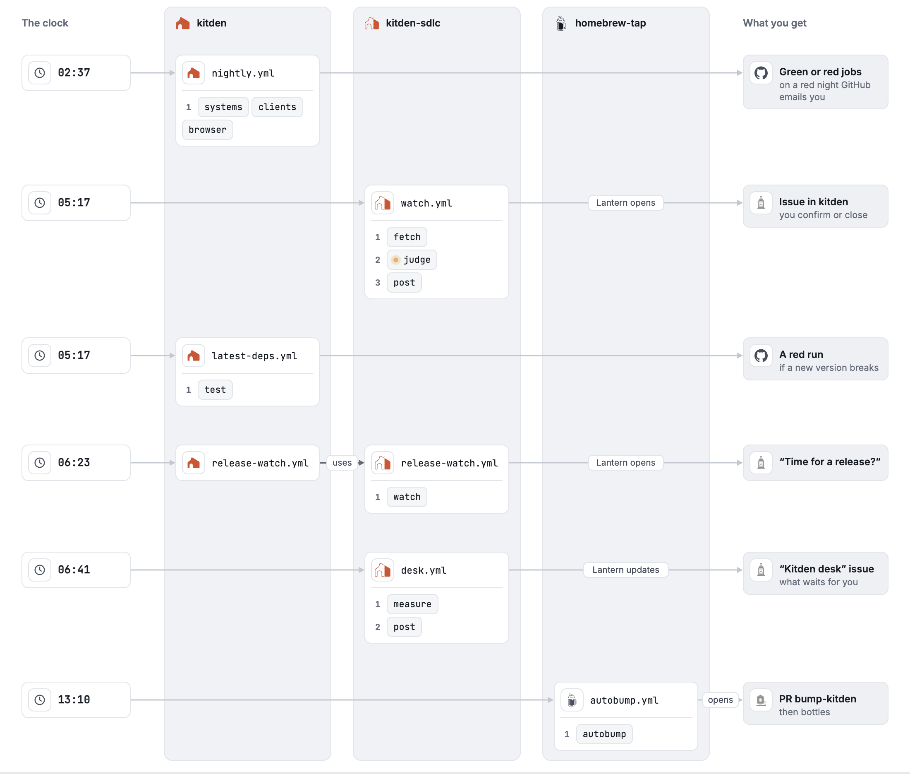
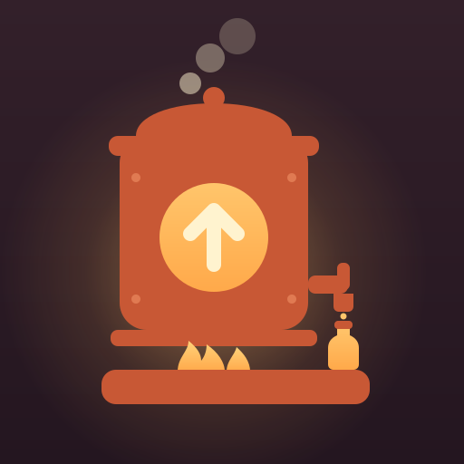

  

<h1 align="center">kitden-sdlc</h1>

  AI reviewers, a client watcher and a release flow for
  <a href="https://github.com/KonstantinStarovoytov/kitden">Kitden</a>. 
  The job that runs a model can never write.

  

  
  

## What it does

- **Reviews every pull request.** Claude and Luna read it; you get one comment. It never blocks.
- **Watches the clients every day.** When Claude Code, Codex or Cursor changes something Kitden reads, you get an issue.
- **Ships releases.** You press one button and merge one pull request. PyPI, GitHub, the MCP Registry and Homebrew follow.

The [live map](https://konstantinstarovoytov.github.io/kitden-sdlc/map/) shows every workflow, what starts it, its jobs and their steps.
The three pictures below are its three stories. A column is a place; an arrow says why the
next thing starts; a dot on a job means a model runs in it.

### A pull request

<picture>
  <source media="(prefers-color-scheme: dark)" srcset="docs/images/map-pull-request-dark.png">
  
</picture>

### A release

<picture>
  <source media="(prefers-color-scheme: dark)" srcset="docs/images/map-release-dark.png">
  
</picture>

### Every day

<picture>
  <source media="(prefers-color-scheme: dark)" srcset="docs/images/map-every-day-dark.png">
  
</picture>

## The bots

Everything is posted by one of three GitHub Apps, so you see who did what.

| | Bot | What it does |
|---|---|---|
|  | **Lantern** | review comments and issues |
|  | **Beacon** | the release pull request, the tag, the Homebrew pull request |
|  | **Kettle** | the daily Homebrew update |

## The rule

No job holds untrusted text, a secret and write access together. So the work is split in
three: one job reads, one runs the model with no way to write, one writes with no model.

All eleven rules, checked by a script on every change: [RULES.md](RULES.md).

## It checks itself

The agents are measured, and what they get wrong becomes the next test.

- **Your verdict is the data.** You mark a watcher issue `confirmed` or `false-alarm`.
- **Verdicts become tests.** About once a month they are turned into new eval tasks, as a pull request: [evals/watch](evals/watch/README.md).
- **No change without a score.** A change to a prompt, a skill or a model comes with its eval table, before and after.
- **A noisy agent pauses itself.** When more than half of its last 10 verdicts are false alarms, it stops and asks you.

The desk shows the same health every day in one issue: [docs/agents.md](docs/agents.md#the-desk).

## What you do

Read the comments, answer the issues, press **Run workflow** to release. Every action and
the three switches that turn it all off: [docs/owner.md](docs/owner.md).

## Use it yourself

Copy the callers in [examples/](examples/) into your `.github/workflows/`, rewrite the
Kitden-specific skills and prompts, then do the one-time setup:
[docs/setup.md](docs/setup.md) and [docs/release-setup.md](docs/release-setup.md).

## More

- [docs/agents.md](docs/agents.md): every agent and workflow, the watcher's labels, the release flow
- [docs/owner.md](docs/owner.md): everything you do, one table; the switches
- [desk.json](https://github.com/KonstantinStarovoytov/kitden-sdlc/blob/numbers/desk.json) on the `numbers` branch: the desk's data
- [docs/setup.md](docs/setup.md) and [docs/release-setup.md](docs/release-setup.md): the one-time setup
- [docs/decisions.md](docs/decisions.md): every standing choice, why, and when to look again
- [LOG.md](LOG.md): what went wrong while building, and what changed
- Designs: [reviewers](docs/design.md), [client watcher](docs/watcher-design.md),
  [release flow](docs/superpowers/specs/2026-11-12-release-flow-design.md)
- [MERGE_POLICY.md](MERGE_POLICY.md): what agents may and may not do to a pull request
- Evals: [review tasks](evals/README.md), [watch tasks](evals/watch/README.md)
