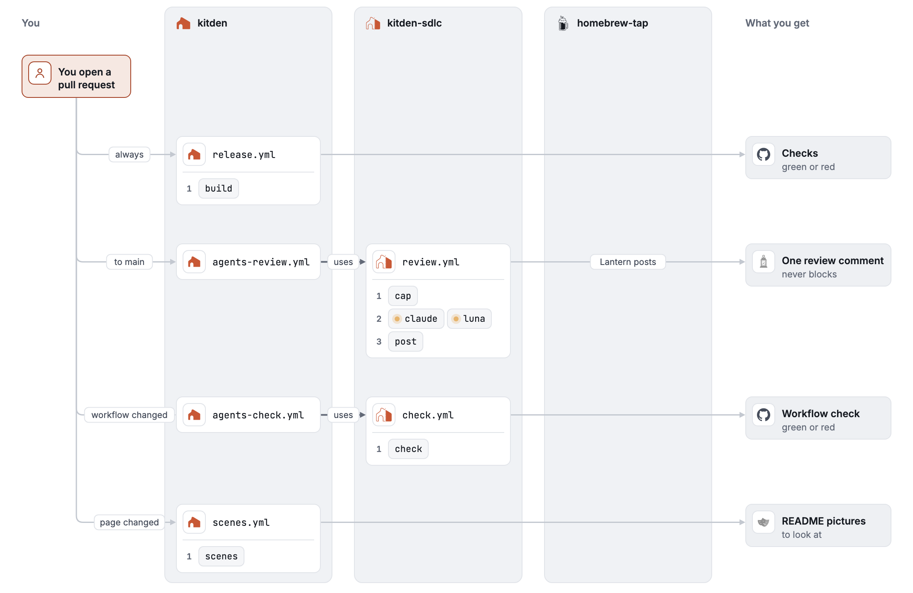
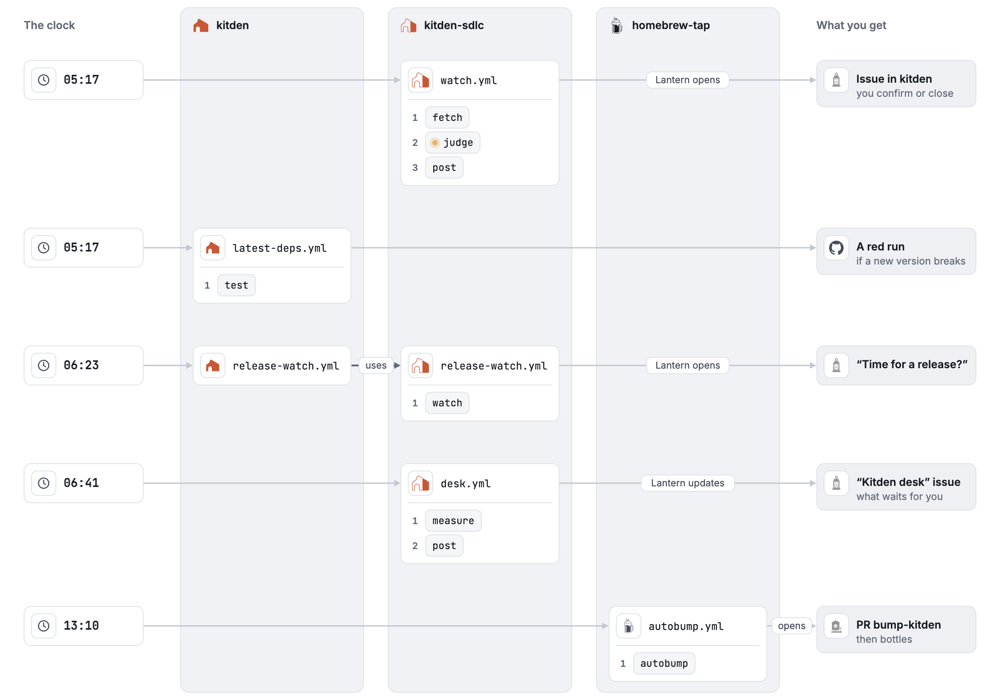

  

# kitden-sdlc

AI reviewers, a client watcher and a release flow for
[Kitden](https://github.com/KonstantinStarovoytov/kitden), with rules so no agent job holds
untrusted text, a secret and write access at once.

 

**[Open the live map](https://konstantinstarovoytov.github.io/kitden-sdlc/map/)**: every
workflow in Kitden, kitden-sdlc and the Homebrew tap, what starts it, its jobs and their steps.
The three pictures below are its three stories.

Every agent, its model and its limits: [docs/agents.md](docs/agents.md).

## The bots

All the automation posts as one of three GitHub Apps, so you always see which one did what.

| | Bot | What it does |
|---|---|---|
|  | **Lantern** `kitden-lantern[bot]` | posts the "Agent review" comment; opens the watcher's and the release watch's issues; keeps the "Kitden desk" issue and opens the "… is paused" issue |
|  | **Kitden Beacon** `kitden-beacon` | opens the release pull request, tags the release, moves the `release` branch, opens the Homebrew pull request |
|  | **Kitden Kettle** `kitden-kettle` | keeps the Homebrew formula up to date in the tap, every day |

## What causes what

A column is a place: you, Kitden, kitden-sdlc, the Homebrew tap, what you get. An arrow says
why the next thing starts. A dot on a job means a model runs in it.

### A pull request

<picture>
  <source media="(prefers-color-scheme: dark)" srcset="docs/images/map-pull-request-dark.png">
  
</picture>

The cap is 10 reviews a day by default; Kitden's caller sets `AGENTS_REVIEW_DAILY_CAP`, or 20.

### A release

<picture>
  <source media="(prefers-color-scheme: dark)" srcset="docs/images/map-release-dark.png">
  
</picture>

You never open an issue for a release. In Kitden on GitHub: **Actions → Release prep → Run
workflow**, keep "Use workflow from" on `main`, keep the version on **Auto** (or pick
**Features (0.X.0)** or **Fixes (0.0.X)**), press the green **Run workflow**. Then review and
merge the pull request **Kitden X.Y.Z**.

### Every day

<picture>
  <source media="(prefers-color-scheme: dark)" srcset="docs/images/map-every-day-dark.png">
  
</picture>

What you do with each issue: [docs/owner.md](docs/owner.md). Bots never write `@name`. Every
issue a bot opens has the label `automated` and one label that says where it comes from:
`client-change`, `release` or `desk`. [What each mark in a bot's text means](docs/agents.md#one-look).

Three switches stop it all: `AGENTS_ENABLED` (everything), `REVIEW_LIVE` (the two reviewers)
and `WATCH_LIVE` (the watcher's daily run). `AGENTS_ENABLED` is two variables, one in Kitden
(review and release) and one in kitden-sdlc (the watcher and the desk's posting; the numbers
are still counted); to stop everything, turn off both.

## The rules

Every workflow that runs an agent must follow [RULES.md](RULES.md). A script checks them.

1. No job holds untrusted text, a secret and write permission together. A job in the
   `release` environment never runs a model.
2. `pull_request` only; skip forks, bots and when the switch is off. A scheduled agent runs
   on a schedule or by hand only, and every job checks the switch.
3. `permissions: {}` at the top; each job asks for the least.
4. Every action is pinned to a full SHA. The caller may use this repository's workflows at
   `main`, which is protected.
5. Every agent job has a timeout, a turn limit and one run per pull request. Luna has only
   a 12-minute step limit. An agent that is a script has `MAX_MODEL_CALLS` and runs one at a
   time.
6. Tools are allowed by exact name: no Bash, web or MCP. Claude reads only the checkout. Text
   that looks like a secret, or holds a long random string the model was not given, is refused.
   Before that check the model's output is a run artifact: kept a day for the reviewers and the
   release agent, seven for the watcher. Luna can run shell commands, but only in a read-only
   sandbox without network, and it can read more than the checkout.
7. Secrets arrive as named inputs and are never printed; the Claude token and the OpenAI key
   never share a job.
8. A text an agent wrote says that it is automated and which model wrote it: the review
   comment by its "Agent review" title, the release pull request in its small print. An issue
   a bot opens has the bot as its author and the label `automated`; the run log names the
   model.
9. A job that runs a model starts with Harden-Runner, which for now only records the hosts it
   reaches.
10. A model step never prints its full output or debug logs.
11. No agent is in anyone's way: no required check, no approving or requesting changes, no red
    mark when a reviewer fails. No agent closes, locks or labels what a person opened; a bot
    knows its own issues by their author.

## Copy this

The callers in [examples/](examples/) are Kitden's own workflow files. Copy them into your
`.github/workflows/`, rewrite the Kitden-specific skills and prompts, then do the one-time
setup: [docs/setup.md](docs/setup.md) for review and the watcher,
[docs/release-setup.md](docs/release-setup.md) for the release flow.

## More

- [docs/agents.md](docs/agents.md): every agent and workflow, the watcher's labels, the release flow
- [docs/owner.md](docs/owner.md): everything you do, one table; the switches
- [desk.json](https://github.com/KonstantinStarovoytov/kitden-sdlc/blob/numbers/desk.json) on the `numbers` branch: the desk's data
- [docs/setup.md](docs/setup.md) and [docs/release-setup.md](docs/release-setup.md): the one-time setup
- [docs/decisions.md](docs/decisions.md): every standing choice, why, and when to look again
- [LOG.md](LOG.md): what went wrong while building, and what changed
- Designs: [reviewers](docs/design.md), [client watcher](docs/watcher-design.md),
  [release flow](docs/superpowers/specs/2026-11-12-release-flow-design.md)
- [MERGE_POLICY.md](MERGE_POLICY.md): what agents may and may not do to a pull request
- Evals: [review tasks](evals/README.md), [watch tasks](evals/watch/README.md)
